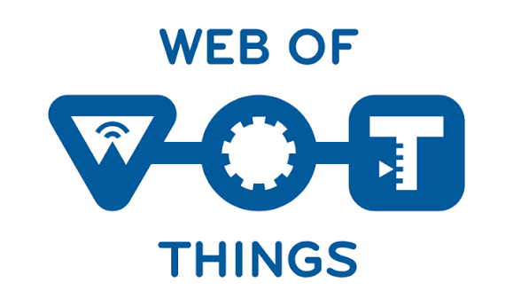
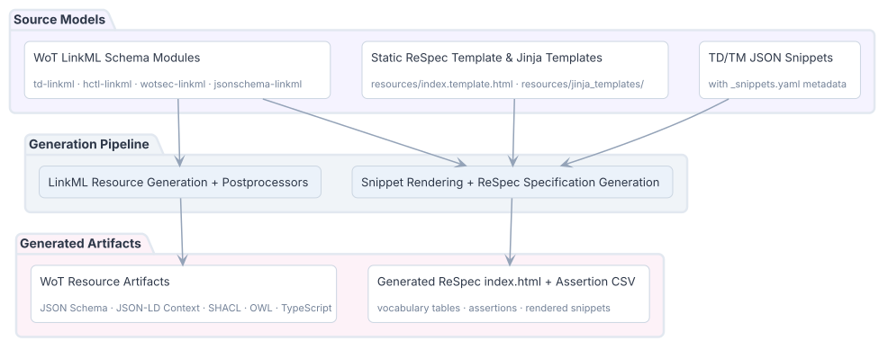

<div align="center">



# WoT Toolchain

**LinkML-based generation of Web of Things artifacts.**

[](https://github.com/w3c/wot-thing-description-toolchain-tmp/actions/workflows/main.yaml)
[](https://www.w3.org/WoT/)
[](https://www.python.org/)
[![LinkML](https://img.shields.io/badge/schema--driven-LinkML-2D6A4F?logo=&logoColor=white)](https://linkml.io/)
[](LICENSE.md)

</div>

The WoT Toolchain is a work area for moving Web of Things (WoT) resource generation to LinkML schema modules. It is intended to replace the manual maintenance of WoT resources — SHACL shapes, JSON Schema, JSON-LD context files, OWL ontologies — and the `index.html` specification generation currently handled by the [existing toolchain](https://github.com/w3c/wot-thing-description/tree/main/toolchain) in the [W3C WoT Thing Description repository](https://github.com/w3c/wot-thing-description).

The toolchain models WoT resources in LinkML and generates the related artifacts from the same schema modules. Its aim is to prevent drift between those resources and the generated HTML sections of the [WoT Thing Description specification](https://www.w3.org/TR/wot-thing-description/).

> [!IMPORTANT]
> This work area is in progress. The toolchain is intended to be integrated into the official [TD](https://github.com/w3c/wot-thing-description/) repository after review and Working Group consensus.

## Usage

Requirements: Python 3.14, [uv](https://docs.astral.sh/uv/) and [Graphviz](https://graphviz.org/).

```bash
git clone https://github.com/w3c/wot-thing-description-toolchain-tmp.git
cd wot-thing-description-toolchain-tmp
uv sync --locked
uv run wot-toolchain generate-wot-resources
uv run pytest tests/
```

The checkout also needs the reference files in `resources/upstream/`, which are not tracked; see [Set up a checkout](docs/contributing/setup.md).
What is generated, from which schemas and into which files is described by the config file [`wot-toolchain.yaml`](wot-toolchain.yaml) ([reference](docs/reference/config-file.md)); the commands and options are in the [CLI reference](docs/reference/cli.md).

Another repository installs a tagged release and runs it against its own config file:

```bash
uv tool install git+https://github.com/w3c/wot-thing-description-toolchain-tmp@<tag>
wot-toolchain generate-wot-resources -c path/to/wot-toolchain.yaml
```

See [Getting started](docs/getting-started.md).

## How It Works

The source models are maintained manually by the WoT Working Group:

- **WoT LinkML schema modules** — the root module [`td-linkml`](resources/schemas/thing_description.yaml) imports [`hctl-linkml`](resources/schemas/hypermedia.yaml), [`wotsec-linkml`](resources/schemas/wot_security.yaml), and [`jsonschema-linkml`](resources/schemas/jsonschema.yaml)
- **Static ReSpec template and Jinja templates** — `resources/index.template.html` and `src/wot_toolchain/templates/`
- **TD/TM JSON snippets** — example snippets with `_snippets.yaml` metadata

From these source models, the generation pipeline has two paths:

1. **LinkML resource generation + postprocessors** takes the schema modules and produces the following WoT resource artifacts under `resources/gens/`:
   - **JSON Schema** (`jsonschema/jsonschema.json`) — validation of TD and TM JSON representations
   - **JSON-LD context** (`jsonldcontext/context.jsonld` and one context per schema module) — TD JSON-LD terms, types, and containers
   - **SHACL shapes** (`shacl/shapes.shacl.ttl`, experimental) — validation of RDF representations of TD and TM instances
   - **OWL ontologies** (`owl/td.ttl`, `owl/tm.ttl`, `owl/hctl.ttl`, `owl/wotsec.ttl`, `owl/jsonschema.ttl`, experimental) — WoT vocabulary terms and relationships
   - **Visualizations** (`visualization/*.svg`, experimental) — class-hierarchy diagrams

2. **Snippet rendering + ReSpec specification generation**, which runs when `spec` is listed under `generators` in `wot-toolchain.yaml`, takes the schema modules, `resources/index.template.html`, Jinja templates, and the TD/TM JSON snippets. It produces:
   - **Generated ReSpec `index.html`** — vocabulary tables, assertions, and rendered TD/TM example snippets
   - **Assertion CSV inventory** (`assertions/`) — inventory of assertions in the TD specification



The code in [`src/wot_toolchain/artifacts/`](src/wot_toolchain/artifacts/) subclasses the LinkML generators and runs passes on their output. It changes the LinkML generator output only where the generator cannot represent a TD requirement directly or needs a documented adjustment to produce the required TD representation. [`LinkML gaps`](docs/contributing/linkml-gaps.md) records each known limitation and workaround.

## Testing

Run the tests after generating the artifacts:

```bash
uv run pytest tests/
```

What each test covers, the expected-failure lists and the snapshot update rules are described in [Testing](docs/contributing/testing.md).

## Documentation

The documentation in [`docs/`](docs/index.md) is published at <https://w3c.github.io/wot-thing-description-toolchain-tmp/>.
Before changing a schema or generator, read [Your first schema change](docs/editing-schemas/first-change.md) and the [annotations](docs/reference/annotations.md) and [naming conventions](docs/reference/naming-conventions.md) references.

## Current Status

Current work focuses on JSON Schema parity, generated TD specification vocabulary tables, snippet validation, and assertion inventory comparison with the upstream TD repository. The JSON Schema, the JSON-LD context, and the specification HTML with its assertion inventory are the release targets. The OWL, SHACL, and visualization outputs are experimental: they are generated and covered by snapshot and structural tests, but deeper automated consistency checks for them are not currently part of the CI test gates.

## Contributing

Contributions, issue reports, and review are welcome. Keep each change focused, generate the affected artifacts, and run the relevant checks before opening a pull request. For schema and generated-output changes, describe the compatibility impact in the pull request.

## License

Licensed under the [W3C Software and Document License](http://www.w3.org/Consortium/Legal/copyright-software), the same license as
[w3c/wot-thing-description](https://github.com/w3c/wot-thing-description). See [LICENSE.md](LICENSE.md).
